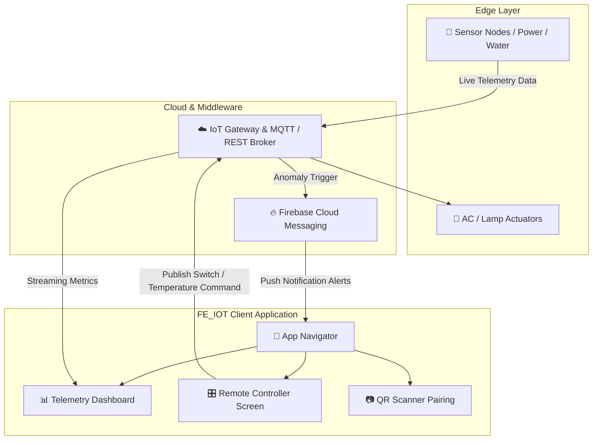

<div align="center">

```
  ███████╗███████╗    ██╗ ██████╗ ████████╗
  ██╔════╝██╔════╝    ██║██╔═══██╗╚══██╔══╝
  █████╗  █████╗      ██║██║   ██║   ██║   
  ██╔══╝  ██╔══╝      ██║██║   ██║   ██║   
  ██║     ███████╗    ██║╚██████╔╝   ██║   
  ╚═╝     ╚══════╝    ╚═╝ ╚═════╝    ╚═╝   
```

### ⚡ Next-Gen Smart Campus & Facility IoT Ecosystem ⚡
*A real-time, cross-platform Mobile IoT Telemetry & Environmental Control Client built with React Native & Expo.*

<br/>

[](https://reactnative.dev/)
[](https://expo.dev/)
[](https://firebase.google.com/)
[](LICENSE)

</div>

---

## 🛰️ Project Overview

**FE_IOT** adalah aplikasi mobile cerdas berbasis **React Native & Expo** yang dirancang sebagai pusat kendali (*command center*) dan monitoring fasilitas infrastruktur IoT kampus/gedung cerdas (*Smart Campus & Building Management*). 

Sistem ini menghubungkan perangkat sensor telemetri secara real-time, menyediakan kontrol jarak jauh untuk otomasi gedung (AC, Lampu, Saklar), manajemen alokasi daya listrik (*Power Meter*) & air (*Water Meter*), serta sistem peringatan dini melalui integrasi notifikasi push Firebase Cloud Messaging (FCM).

---

## 🔮 Core Architecture & Screen Matrix

```
📦 FE_IOT
 ├── 📂 src
 │    ├── 📂 components   # Reusable UI & Micro-animations (OrbitingNetwork, SwipeableToast, etc.)
 │    ├── 📂 context      # Global State Management (UserContext, ThemeEngine, Role-Based Access)
 │    ├── 📂 screens      # Modular View Controllers (Telemetry, Devices, Audit, Users)
 │    └── 📂 services     # API Client, Network Adapters, AuthService & IoT Streamers
 ├── 📜 App.js            # Dynamic Navigation Router & Theme Provider
 ├── 📜 app.json          # Expo Application Manifest & Bundle Configuration
 └── 📜 package.json      # Dependency Registry
```

### 🎛️ Feature Matrix

| Modul | Deskripsi Fungsional |
| :--- | :--- |
| **🌐 Telemetry Dashboard** | Visualisasi data sensor real-time, agregat statistik suhu, kelembaban, dan kualitas udara melalui chart interaktif. |
| **⚡ Power & Water Metering** | Monitoring konsumsi daya listrik (kWh) dan debit air secara live dengan metrik efisiensi energi. |
| **❄️ AC & Climate Control** | Pengendalian temperatur suhu, mode pendingin, fan speed, dan penjadwalan unit AC secara terpusat. |
| **💡 Lighting Automation** | Kontrol saklar lampu individual maupun zonasi ruangan secara nirkabel. |
| **📷 QR & Device Scanner** | Fitur scanner kamera untuk *quick-pair* dan identifikasi instan perangkat IoT di lapangan. |
| **🔐 SSO & Role Access** | Single Sign-On (SSO) multi-peran (Superadmin, Teknisi, Mahasiswa/Karyawan) dengan hak akses granular. |
| **🔔 Instant Alarm & FCM** | Notifikasi bahaya dan peringatan threshold sensor via Firebase Cloud Messaging. |

---

## ⚡ System Telemetry Flow



---

## 🚀 Getting Started

### Prerequisites
* **Node.js**: v18.0.0 atau lebih baru
* **Package Manager**: npm atau yarn
* **Expo Go Client**: Terpasang di smartphone Android / iOS

### Installation & Launch

1. **Clone repository:**
   ```bash
   git clone https://github.com/alfab3t/FE_IOT.git
   cd FE_IOT
   ```

2. **Install dependensi:**
   ```bash
   npm install
   ```

3. **Jalankan development server:**
   ```bash
   npx expo start
   ```

4. **Jalankan pada Target Platform:**
   * Tekan `a` untuk membuka di Emulator Android.
   * Tekan `i` untuk membuka di Simulator iOS.
   * Pindai QR Code menggunakan aplikasi **Expo Go** untuk menguji langsung di ponsel fisik.

---

## 💻 Tech Stack & Dependencies

* **Core Framework:** [React Native](https://reactnative.dev/) (v0.81) via [Expo SDK 54](https://expo.dev/)
* **Navigation:** React Navigation v6 (Native Stack)
* **Visualization:** `react-native-chart-kit`, `react-native-svg`
* **Icons & Animation:** `lucide-react-native`, Custom Easing Micro-Animations
* **Hardware & Sensor Access:** `expo-camera`, `expo-device`, `expo-notifications`
* **Local Storage:** `@react-native-async-storage/async-storage`

---

## 👨‍💻 Author & Engineering Credits

Developed with passion by **[Djohan (@alfab3t)](https://github.com/alfab3t)**  
*Smart Campus & Industrial IoT Frontend Project • Kelompok 7*

<div align="center">
  <sub>Part of Advanced Mobile Computing & Industrial IoT Systems Engineering</sub>
</div>
